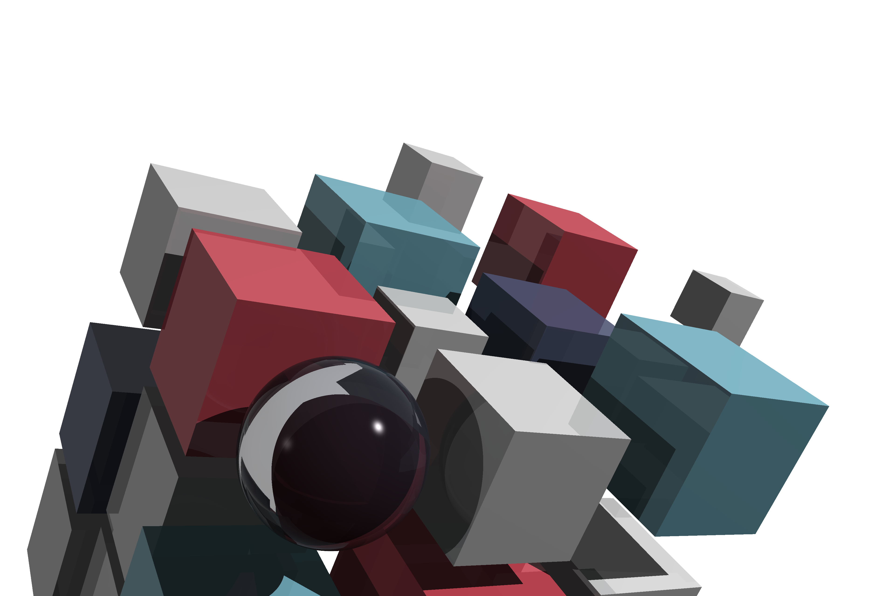
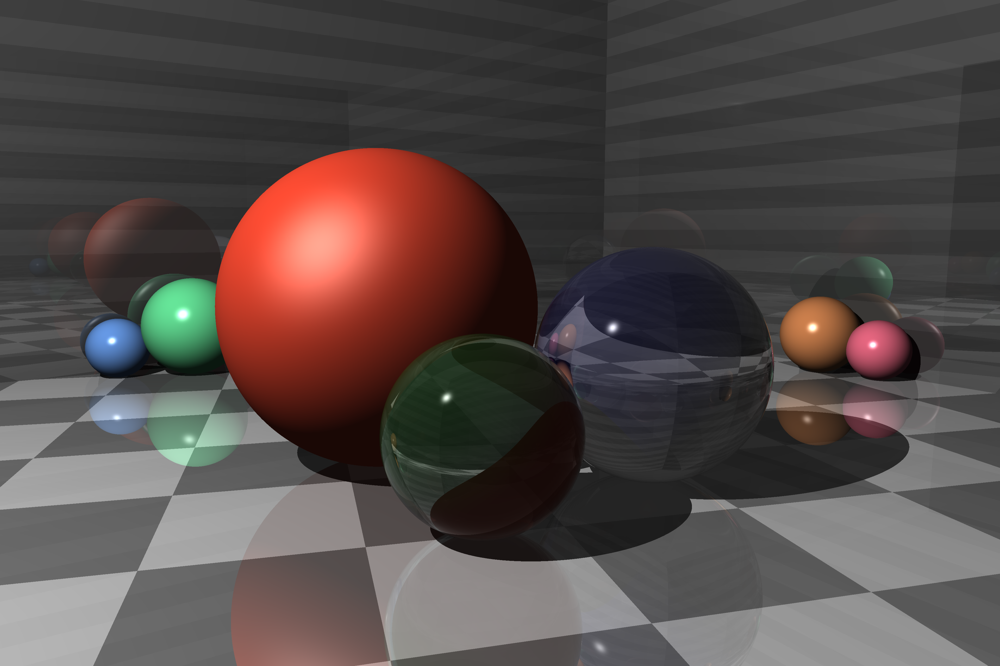
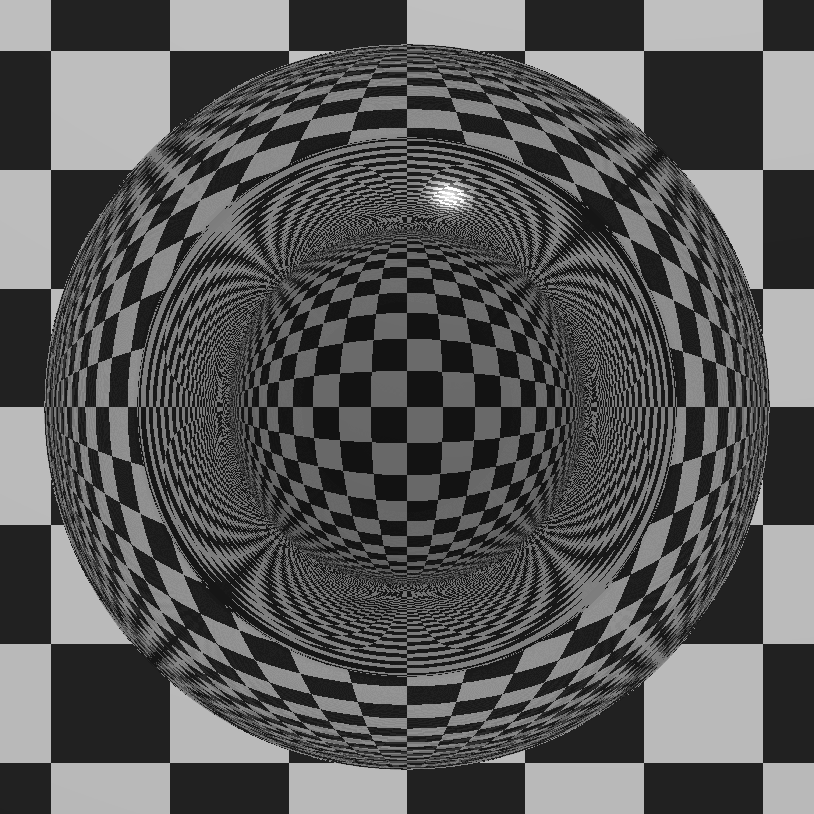
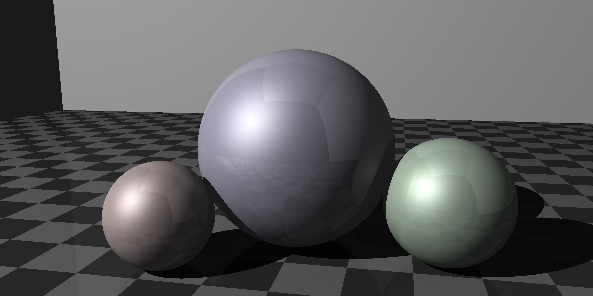
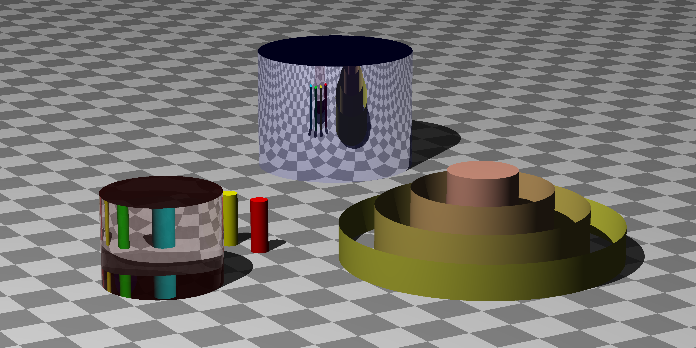
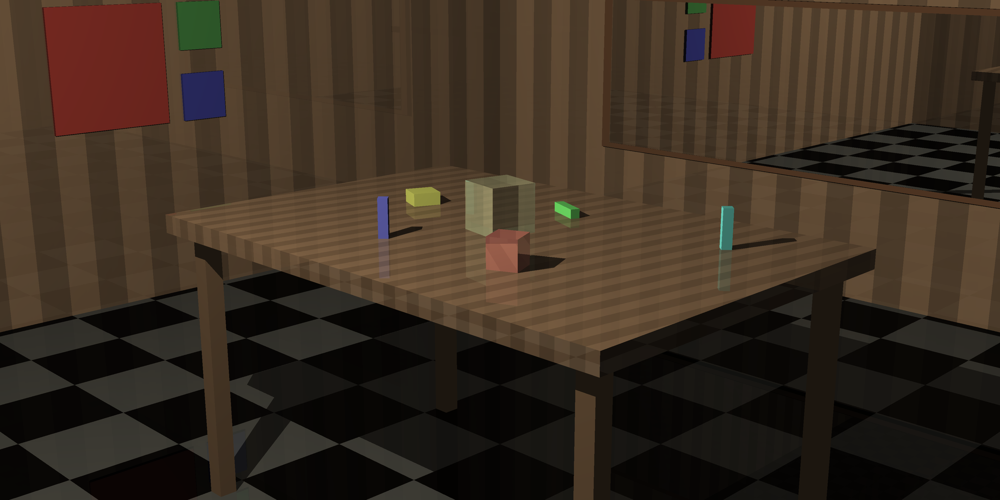
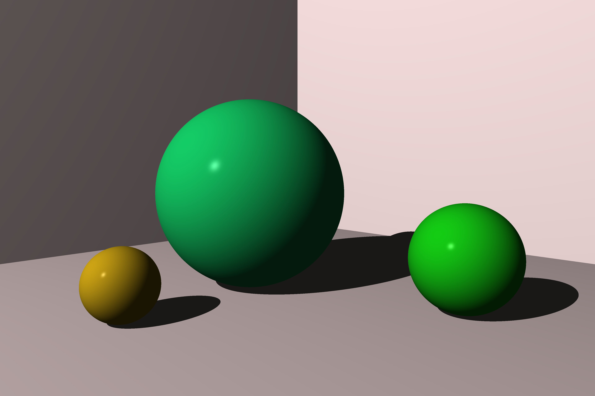
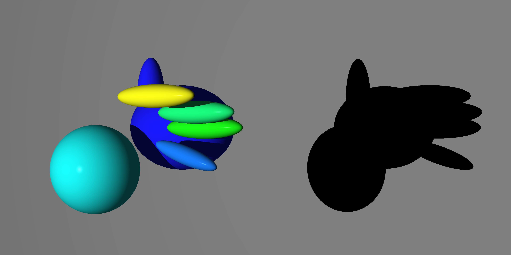

# ray tracer challenge

[](https://github.com/przemo199/ray-tracer-challenge-rs/actions/workflows/ci.yml)

Implementation of the ray tracer from *The Ray Tracer Challenge* book by [Jamis Buck](mailto:jamis@jamisbuck.org)
in Rust: a library (`ray-tracer`) and a command-line renderer for YAML scene files (`ray-tracer-cli`).



## Features

- Parallel rendering with [rayon](https://github.com/rayon-rs/rayon)
- Any number of light sources, and objects that don't cast shadows
- Matrices implemented with const generics
- Shapes and patterns as traits; patterns can be nested and transformed independently
- Scene files are validated: typos, undefined names and invalid transforms are reported with line and column
- No `unsafe` code

## Building and running

```sh
cargo run --release -p ray-tracer-cli -- scenes/cover.yaml cover.png
```

Always build with `--release` for rendering; debug builds are many times slower. The example scenes in
`scenes/` render at 4K, which takes a while — lower the camera's `width`/`height` for a quick preview.

```
Usage: ray-tracer-cli [OPTIONS] <SCENE_PATH> <IMAGE_OUTPUT_PATH>

Arguments:
  <SCENE_PATH>         YAML scene file to render
  <IMAGE_OUTPUT_PATH>  Where to write the rendered PNG image

Options:
  -r, --rendering-mode <RENDERING_MODE>  [default: parallel] [possible values: serial, parallel]
  -q, --quiet                            Print nothing, not even the progress bar
  -h, --help                             Print help
  -V, --version                          Print version
```

## Scene files

Scenes use the YAML format from the book: a list of entries that either `add` something to the scene or
`define` a reusable material, transform or color.

```yaml
- add: camera
  width: 800
  height: 600
  field-of-view: 1.05
  from: [0, 1.5, -5]
  to: [0, 1, 0]
  up: [0, 1, 0]

- add: light
  at: [-10, 10, -10]
  intensity: [1, 1, 1]

- define: glass-material
  value:
    color: [0.1, 0.1, 0.1]
    transparency: 0.9
    refractive-index: 1.5
    reflective: 0.9

- add: plane
  material:
    pattern:
      type: checkers
      colors: [[1, 1, 1], [0, 0, 0]]

- add: sphere
  material: glass-material
  transform:
    - [scale, 0.5, 0.5, 0.5]
    - [translate, 0, 1, 0]
```

- **Shapes:** `plane`, `sphere`, `cube`, and `cylinder`/`cone` (with optional `min`, `max`, `closed`).
  Any shape can set `shadow: false`.
- **Transforms** apply in list order: `scale`, `translate` (x, y, z), `rotate-x`/`-y`/`-z` (radians),
  or the name of a defined transform.
- **Materials:** `color`, `pattern`, `ambient`, `diffuse`, `specular`, `shininess`, `reflective`,
  `transparency`, `refractive-index`, `casts-shadow`. A defined material can `extend` another one.
- **Patterns:** `stripes`, `gradient`, `rings`, `checkers`, each with two `colors` and an optional `transform`.

More examples are in [`scenes/`](scenes).

## Development

```sh
cargo test --workspace                 # unit, integration (incl. golden images), CLI and doc tests
cargo clippy --workspace --all-targets
cargo fmt --all
scripts\bench.cmd                      # Criterion benchmarks (Windows; pins the run to one core)
```

Contributor and AI-agent guidelines — code conventions, where tests go, how to benchmark — are in
[AGENTS.md](AGENTS.md).

## Examples














